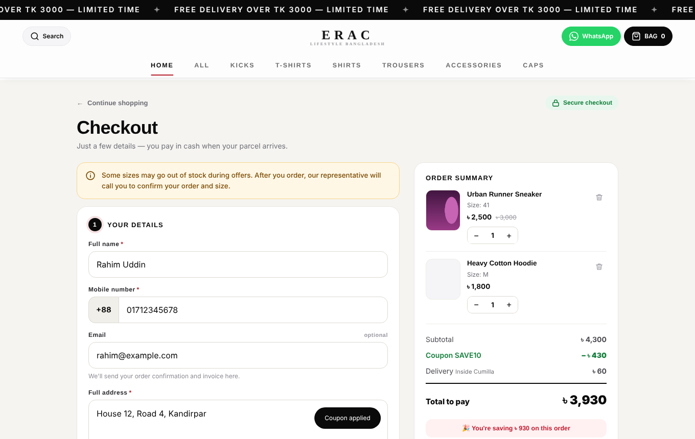
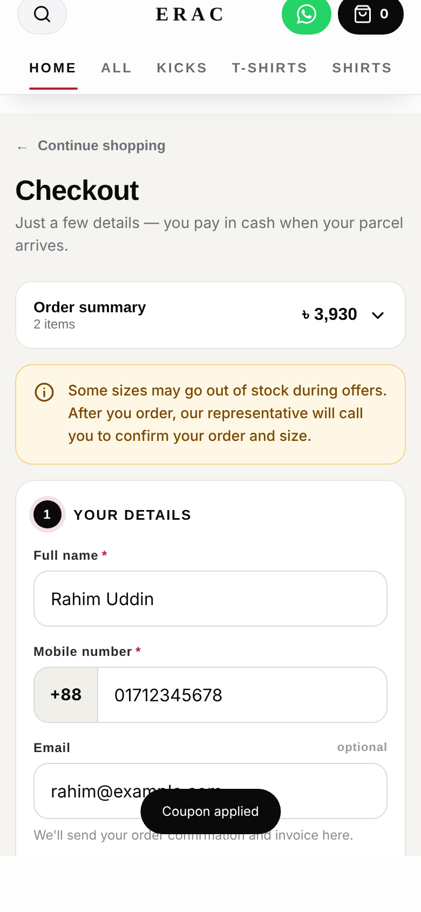
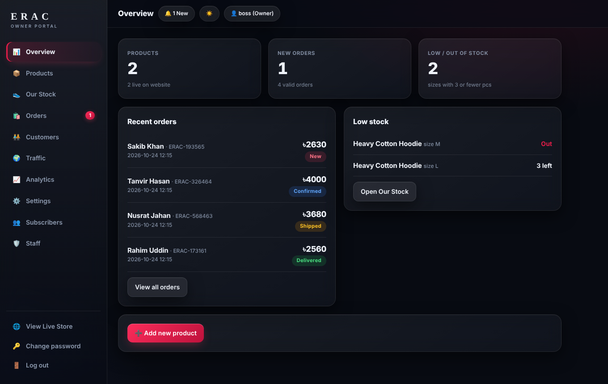
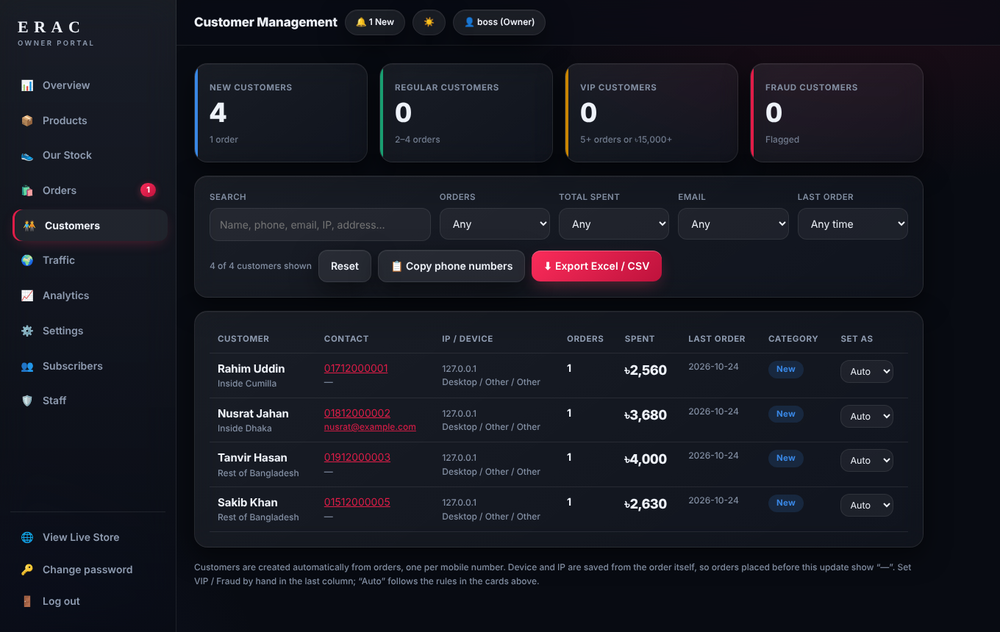
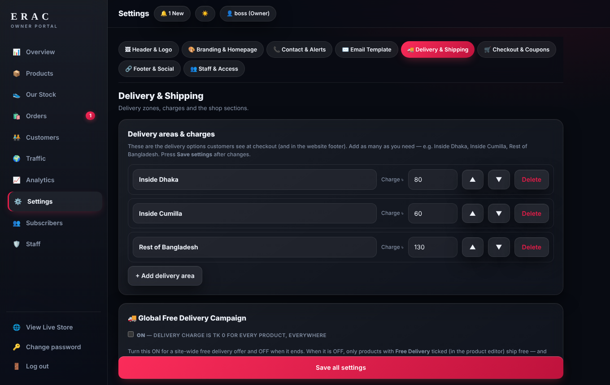
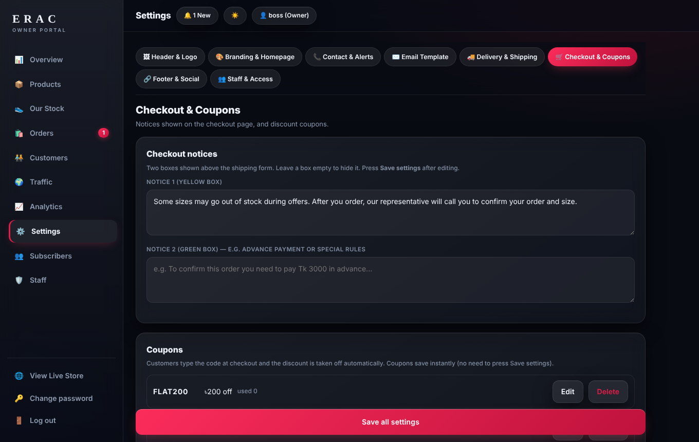
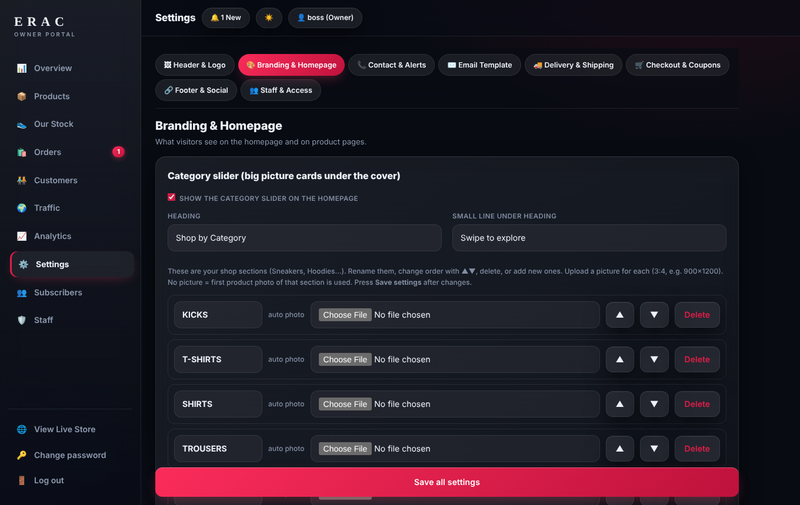
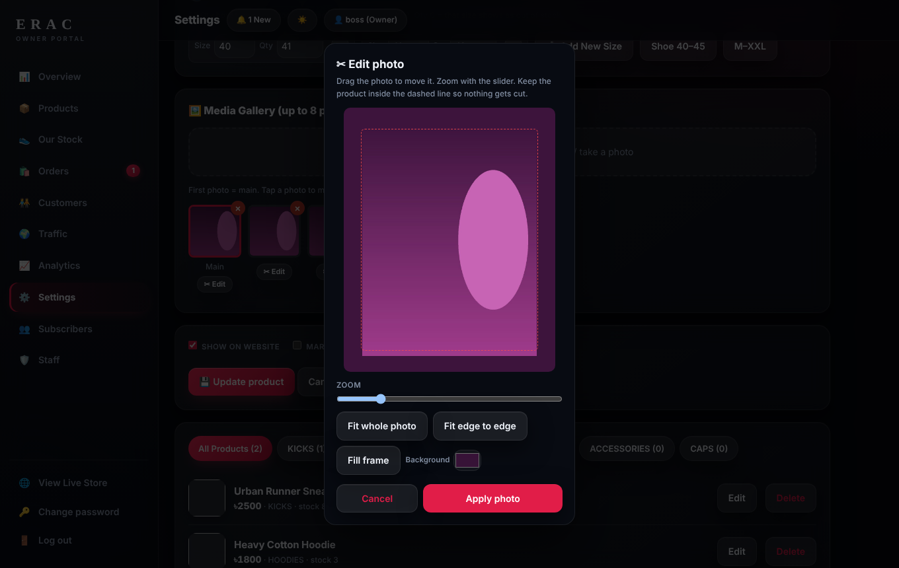

# Erac Lifestyle — E-commerce Platform (Showcase)

A custom-built, mobile-first online store and owner dashboard for **Erac Lifestyle**, a Bangladesh-based fashion & footwear brand.
Designed, built and operated by **Ruhan** (Head of Management & Operations, BTL).

> 🔒 The source code is private. This repository only showcases the product through screenshots and a feature overview.

🌐 Live store: **eraclifestyle.com**

---

## Overview

Erac is a lightweight, fast storefront with a full owner portal — no heavy frameworks, no monthly platform fees. Everything a small brand needs to sell, ship and grow is built in: orders, customers, delivery rules, coupons, analytics and email.

## Features

### Storefront
- Mobile-first single-page storefront, fast on slow connections
- Category marquee with auto-slide, home page sections managed from the panel
- Product gallery with size selection, stock-aware buttons
- Dedicated **/checkout** page: order summary, notices, coupon field, Cash on Delivery
- Division → district selector for all of Bangladesh with automatic delivery charge
- WhatsApp / Messenger order confirmation shortcuts
- SEO: sitemap, structured data, per-page meta, noindex for checkout

### Owner Portal
- **Orders** — status workflow (New → Confirmed → Shipped → Delivered / Cancelled)
- **Customers** — auto-created from orders, New / Regular / VIP / Fraud classification, search, filters, CSV export
- **Delivery zones** — editable zone cards (e.g. Inside Dhaka / Outside Dhaka) synced across checkout and footer
- **Free delivery** — per-product flag and a global campaign switch
- **Coupons** — fixed / percentage, limits and validity, created from the panel
- **Category manager** — add, rename, reorder, show/hide
- **Homepage builder** — banners, sections and notices editable without code
- **Photo editor** — built-in crop / zoom / padding tool for product photos
- **Traffic & analytics** — visitors, cities, top pages, sessions
- **Staff accounts** with owner-only permissions for sensitive actions
- Email notifications and subscriber list

## Tech Stack
- Front end: vanilla HTML, CSS and JavaScript (no framework)
- Back end: PHP with a flat-file JSON data store
- Hosting: cPanel / LiteSpeed
- Security: rate limiting, input validation, owner-only endpoints

## Screenshots

### Checkout
| Desktop | Mobile |
|---|---|
|  |  |

### Owner Portal
**Overview**

**Customer management**

**Delivery & shipping**

**Coupons**

**Homepage manager**

**Product photo editor**

---

*All data shown in screenshots is demo data. © Erac Lifestyle — all rights reserved.*
